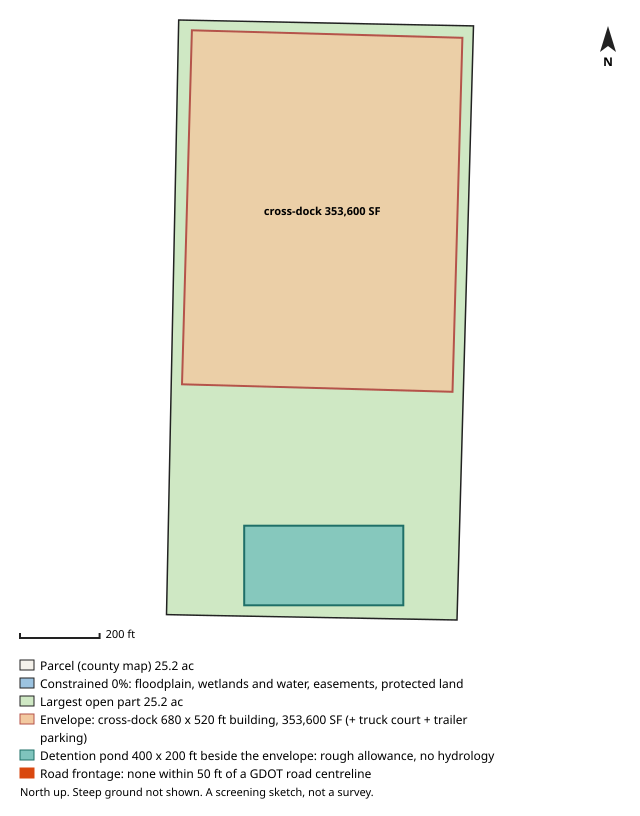

# #11 — 0 ROCK QUARRY RD (Union City)

**Score 78.8** (zoning & ground 71.1, access/land/seller 83.0, seller motivation 60.0) · parcel `13 0095  LL0091` · [map](https://www.google.com/maps/search/?api=1&query=33.6066,-84.494617) · county record: https://qpublic.schneidercorp.com/Application.aspx?AppID=1010

**Lead grade C**
- Found: no public road frontage within 50 ft; the same owner holds 1 built-on parcel adjacent to this one, directly or through its other parcels (possibly spare land of an operating site)

## The site
- 39.6 acres; about 27.6 usable after floodplain, mapped wetlands and ponds, protected land / conservation easements and steep ground. Utility and access easements are not checked
- Zoning: M-2 (Manufacturing and Heavy Industrial); future land use: unknown
- Entitlement path: **by_right** — zoned industrial
- Access: 0.75 mi (straight line) to I-85 exit 68; road: Land-Locked
- Rail: 4,882 ft to CSXT
- Industrial parcels within 1 mile: 32
- Floodplain 0% (none), floodway 0%, wetlands 0%, ponds/streams 0%
- Slope: 30% of the open ground steeper than 15%; relief about 124 ft (USGS lidar 2018-19, 10 m grid)
- Earthwork (rough): about 810,000 cubic yards of cut balanced by the same fill, 39.8 ft average cut or fill, to level the open ground (USGS lidar 2018-19, 10 m grid); one flat pad at the mean elevation of the open ground, not a grading plan: ignores drainage slope, terracing, shrink/swell, topsoil and rock
- Building fit (lower bound): a cross-dock envelope (building + truck court + trailer parking) fits with a 680 x 520 ft building (353,600 SF); largest open-ground part 25.2 acres; a cross-dock fit means the front/rear-load envelope fits too. Checked on open ground inside a 25 ft lot-line setback; open ground excludes floodplain (FEMA SFHA), mapped wetlands and water (NWI), conservation easements (NCED) and protected land (PAD-US); steep ground is not located (slope is applied only as a share, in usable_after_slope), so steep ground may lie inside the open area; car parking, drives, detention, access, coverage caps and zoning setbacks beyond the 25 ft lot-line setback are not modelled
- Detention pond (rough allowance): a 400 x 200 ft pond (top of bank; 6 ft deep, 4:1 side slopes, about 9.1 acre-feet; 1.84 acres, 7.3% of the open ground) fits on the open ground left beside the fitted building envelope. Checked inside the 25 ft lot-line setback, on open ground (the same open ground as the building fit; steep ground is not located); a rough allowance for one fixed prototype pond, not a stormwater design: no hydrology, no NOAA Atlas 14 rainfall, no runoff from the building's impervious area and no local detention rules; the pond may sit right against the envelope with no room left for access, grading or a buffer; the real pond may be larger, smaller, underground or shared
- Soils (USDA SSURGO, 5 map units, 100% of the parcel shape mapped): hydrologic soil group mostly B (98% of the mapped soil; also A/D 0%); hydric components 0%; poorly or very poorly drained 0%; very limited for dwellings without basements (a slab-on-grade proxy) 0%; unrated share of the mapped soil: soil group 2%, drainage 2%, dwellings rating 2%. SSURGO is mapped at about 1:12,000 to 1:24,000 and rated by map unit, not this site: small wet spots, fill and inclusions go unmapped, and it is no substitute for a geotechnical report or a wetland delineation
- Road frontage (GDOT road centrelines): none within 50 ft (nearest non-freeway GDOT road about 389 ft from the parcel line); possibly land-locked or on a private road or drive, check access easements. Measured as the parcel line within 50 ft of a GDOT road centreline, from the county parcel map: up to about 50 ft at each end of a frontage can be a side line near the corner, a wide right-of-way or a misaligned map can hide real frontage, and a road can be close without legal access. Curb cut / driveway access not checked: a manual next step (GDOT for state routes, the city or county for local roads)
- Water / sewer per assessor: All public / unknown
- Opportunity Zone: no

## Site plan

_North up, drawn from the county parcel map: shaded blue is floodplain, mapped wetlands and water, conservation easements and protected land; green is the largest open part; the outlined block is the fitted building envelope and the teal block, when drawn, is the rough detention pond allowance. Steep ground is not shown. A screening sketch, not a survey._

## The owner
- THAMES FAMILY INVESTMENTS LLC (entity)
- Mailing address: 44 ALLGOOD RD, NEWNAN GA 30263
- Last recorded sale: 2006-05-30 for $62,500 (Executor/Executrix Deed)
- Assessor land value: $148,000 ($3,737/acre)

## Why it ranks here
- zoned industrial
- 0.8 mi to I-85 exit 68
- 28 usable acres
- 32 industrial parcels within 1 mile
- same owner for 20 years
- inherited / estate ownership

## Watch-outs
- assessor lists the parcel as land-locked (no road frontage)
- Same owner: the same tax-roll owner name and mailing address is on 3 other 5-50 ac parcels in the jurisdictions searched (73.8 ac with this one): 13 0066  LL0120 (screened out: in the 100-year floodplain), 13 0066  LL0138 (screened out: already built on), 13 0095  LL0109 (screened out: of the open ground is steeper than 15%). Counts cover only that band and area
- Same owner, adjacent: touching or within 10 ft of 3 of them on the county parcel map, directly or through each other: 73.8 ac together with this one, larger than the 5-50 ac search band; acres from the tax record, the parcel map disagrees for some. Check the shared boundary: a corner touch is not frontage
- Same owner, adjacent and built on: 1 same-owner parcel adjacent to this one, directly or through each other, is already built on (13 0066  LL0138). This may be spare land of an operating site rather than land for sale

## Next steps
- Confirm zoning and any conditions with Union City planning
- Confirm a curb cut / driveway permit for truck access (GDOT for a state route, the city or county for a local road): not checked by the screen
- Ask the water/sewer provider about capacity and the nearest main
- Pull title and recent deeds before approaching the owner
- Drive the site: access, neighbours, visible fill or dumping

_Screening estimate from public data (county assessor, FEMA, USFWS, USGS, EPA, GA EPD, GDOT). Not a survey, title search or environmental assessment._
