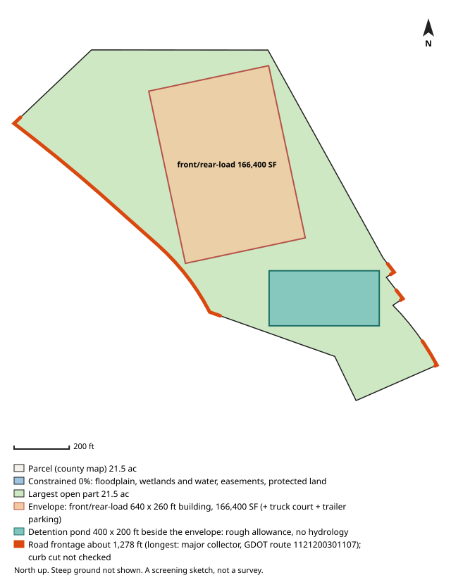

# #13 — 0 CONNALLY DR (East Point)

**Score 78.6** (zoning & ground 88.9, access/land/seller 73.1, seller motivation 40.0) · parcel `14 0156  LL0301` · [map](https://www.google.com/maps/search/?api=1&query=33.688121,-84.442716) · county record: https://qpublic.schneidercorp.com/Application.aspx?AppID=1010

**Lead grade A**: zoning path, building fit, pond room and road frontage all came back clear, and no watch item was found

## The site
- 19.9 acres; about 19.6 usable after floodplain, mapped wetlands and ponds, protected land / conservation easements and steep ground. Utility and access easements are not checked
- Zoning: I1; future land use: MXD
- Entitlement path: **by_right** — zoned industrial
- Access: 1.85 mi (straight line) to I-85 exit 76; road: Paved
- Rail: 304 ft to NS
- Industrial parcels within 1 mile: 85
- Floodplain 0% (none), floodway 0%, wetlands 0%, ponds/streams 0%
- Slope: 2% of the open ground steeper than 15%; relief about 16 ft (USGS lidar 2018-19, 10 m grid)
- Earthwork (rough): about 50,000 cubic yards of cut balanced by the same fill, 2.9 ft average cut or fill, to level the open ground (USGS lidar 2018-19, 10 m grid); one flat pad at the mean elevation of the open ground, not a grading plan: ignores drainage slope, terracing, shrink/swell, topsoil and rock
- Building fit (lower bound): a front/rear-load envelope (building + truck court + trailer parking) fits with a 640 x 260 ft building (166,400 SF); largest open-ground part 21.5 acres. Checked on open ground inside a 25 ft lot-line setback; open ground excludes floodplain (FEMA SFHA), mapped wetlands and water (NWI), conservation easements (NCED) and protected land (PAD-US); steep ground is not located (slope is applied only as a share, in usable_after_slope), so steep ground may lie inside the open area; car parking, drives, detention, access, coverage caps and zoning setbacks beyond the 25 ft lot-line setback are not modelled
- Detention pond (rough allowance): a 400 x 200 ft pond (top of bank; 6 ft deep, 4:1 side slopes, about 9.1 acre-feet; 1.84 acres, 8.6% of the open ground) fits on the open ground left beside the fitted building envelope. Checked inside the 25 ft lot-line setback, on open ground (the same open ground as the building fit; steep ground is not located); a rough allowance for one fixed prototype pond, not a stormwater design: no hydrology, no NOAA Atlas 14 rainfall, no runoff from the building's impervious area and no local detention rules; the pond may sit right against the envelope with no room left for access, grading or a buffer; the real pond may be larger, smaller, underground or shared
- Soils (USDA SSURGO, 1 map unit, 100% of the parcel shape mapped): no hydrologic soil group rated; hydric components 0%; poorly or very poorly drained none rated; very limited for dwellings without basements (a slab-on-grade proxy) none rated; unrated share of the mapped soil: soil group 100%, drainage 100%, dwellings rating 100%. SSURGO is mapped at about 1:12,000 to 1:24,000 and rated by map unit, not this site: small wet spots, fill and inclusions go unmapped, and it is no substitute for a geotechnical report or a wetland delineation
- Road frontage (GDOT road centrelines): about 1,278 ft; longest on major collector, GDOT route 1121200301107 (1,066 ft); also local road, GDOT route 1121200627707 212 ft, local road, GDOT route 1121200623607 93 ft, local road, GDOT route 1121200624307 93 ft. Measured as the parcel line within 50 ft of a GDOT road centreline, from the county parcel map: up to about 50 ft at each end of a frontage can be a side line near the corner, a wide right-of-way or a misaligned map can hide real frontage, and a road can be close without legal access. Curb cut / driveway access not checked: a manual next step (GDOT for state routes, the city or county for local roads)
- Water / sewer per assessor: All public / unknown
- Opportunity Zone: no

## Site plan

_North up, drawn from the county parcel map: shaded blue is floodplain, mapped wetlands and water, conservation easements and protected land; green is the largest open part; the outlined block is the fitted building envelope and the teal block, when drawn, is the rough detention pond allowance. Steep ground is not shown. A screening sketch, not a survey._

## The owner
- S W P C INC (entity)
- Mailing address: 1301 RIVERPLACE BLVD STE 2300, JACKSONVILLE FL 32207
- Last recorded sale: none on file
- Assessor land value: $575,200 ($28,832/acre)

## Why it ranks here
- zoned industrial
- mostly gentle ground
- 1.9 mi to I-85 exit 76
- 20 usable acres
- 85 industrial parcels within 1 mile
- no recorded sale on file (likely long-held)
- owner mails from out of state (FL)

## Watch-outs
- listed contamination site 169 ft away: SOUTHERN WOOD PIEDMONT - EAST POINT (GA EPD HSI)
- listed contamination site 306 ft away: 1745 CONNALLY DR (Middle Chattahoochee-Lake Harding)
- Same owner: the same tax-roll owner name and mailing address is on 1 other 5-50 ac parcel in the jurisdictions searched (58.3 ac with this one): 14 0155  LL0336 (ranked #25). Counts cover only that band and area
- Same owner, adjacent: touching or within 10 ft of 1 of them on the county parcel map, directly or through each other: 58.3 ac together with this one, larger than the 5-50 ac search band. Check the shared boundary: a corner touch is not frontage

## Next steps
- Confirm zoning and any conditions with East Point planning
- Confirm a curb cut / driveway permit for truck access (GDOT for a state route, the city or county for a local road): not checked by the screen
- Ask the water/sewer provider about capacity and the nearest main
- Pull title and recent deeds before approaching the owner
- Drive the site: access, neighbours, visible fill or dumping

_Screening estimate from public data (county assessor, FEMA, USFWS, USGS, EPA, GA EPD, GDOT). Not a survey, title search or environmental assessment._
