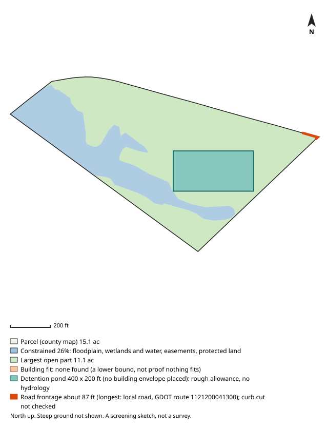

# #22 — 4800 FREDERICK DR (South Fulton / unincorporated)

**Score 75.4** (zoning & ground 71.8, access/land/seller 77.4, seller motivation 50.0) · parcel `14F0084  LL0054` · [map](https://www.google.com/maps/search/?api=1&query=33.761666,-84.547183) · county record: https://qpublic.schneidercorp.com/Application.aspx?AppID=1010

**Lead grade C**
- Found: no building envelope found (a lower bound, not proof); the same owner holds 1 built-on parcel adjacent to this one, directly or through its other parcels (possibly spare land of an operating site)

## The site
- 16.2 acres; about 9.3 usable after floodplain, mapped wetlands and ponds, protected land / conservation easements and steep ground. Utility and access easements are not checked
- Zoning: M-2 (Heavy Industrial); future land use: Industrial Zone
- Entitlement path: **by_right** — zoned industrial
- Access: 0.82 mi (straight line) to I-20 exit 47; road: Paved
- Rail: 12 ft to FCR
- Industrial parcels within 1 mile: 163
- Floodplain 26% (AE), floodway 0%, wetlands 0%, ponds/streams 0%
- Slope: 23% of the open ground steeper than 15%; relief about 26 ft (USGS lidar 2018-19, 10 m grid)
- Earthwork (rough): about 46,000 cubic yards of cut balanced by the same fill, 5.2 ft average cut or fill, to level the open ground (USGS lidar 2018-19, 10 m grid); one flat pad at the mean elevation of the open ground, not a grading plan: ignores drainage slope, terracing, shrink/swell, topsoil and rock
- Building fit: no fit found for the smallest envelope (building + truck court + trailer parking, 400 x 445 ft) (no envelope placement found); largest open-ground part 11.1 acres. The search is a lower bound, so this is not proof that nothing fits. Checked on open ground inside a 25 ft lot-line setback; open ground excludes floodplain (FEMA SFHA), mapped wetlands and water (NWI), conservation easements (NCED) and protected land (PAD-US); steep ground is not located (slope is applied only as a share, in usable_after_slope), so steep ground may lie inside the open area; car parking, drives, detention, access, coverage caps and zoning setbacks beyond the 25 ft lot-line setback are not modelled
- Detention pond (rough allowance): a 400 x 200 ft pond (top of bank; 6 ft deep, 4:1 side slopes, about 9.1 acre-feet; 1.84 acres, 16.5% of the open ground) fits on the open ground; no building envelope was placed, so this does not show room for both. Checked inside the 25 ft lot-line setback, on open ground (the same open ground as the building fit; steep ground is not located); a rough allowance for one fixed prototype pond, not a stormwater design: no hydrology, no NOAA Atlas 14 rainfall, no runoff from the building's impervious area and no local detention rules; the pond may sit right against the envelope with no room left for access, grading or a buffer; the real pond may be larger, smaller, underground or shared
- Soils (USDA SSURGO, 1 map unit, 100% of the parcel shape mapped): no hydrologic soil group rated; hydric components 0%; poorly or very poorly drained none rated; very limited for dwellings without basements (a slab-on-grade proxy) none rated; unrated share of the mapped soil: soil group 100%, drainage 100%, dwellings rating 100%. SSURGO is mapped at about 1:12,000 to 1:24,000 and rated by map unit, not this site: small wet spots, fill and inclusions go unmapped, and it is no substitute for a geotechnical report or a wetland delineation
- Road frontage (GDOT road centrelines): about 87 ft; longest on local road, GDOT route 1121200041300 (87 ft). Measured as the parcel line within 50 ft of a GDOT road centreline, from the county parcel map: up to about 50 ft at each end of a frontage can be a side line near the corner, a wide right-of-way or a misaligned map can hide real frontage, and a road can be close without legal access. Curb cut / driveway access not checked: a manual next step (GDOT for state routes, the city or county for local roads)
- Water / sewer per assessor: All underground / unknown
- Opportunity Zone: no

## Site plan

_North up, drawn from the county parcel map: shaded blue is floodplain, mapped wetlands and water, conservation easements and protected land; green is the largest open part; the outlined block is the fitted building envelope and the teal block, when drawn, is the rough detention pond allowance. Steep ground is not shown. A screening sketch, not a survey._

## The owner
- OWENS CORNING ROOFING AND ASPHALT LLC (entity)
- Mailing address: 1 OWENS CORNING PKWY, TOLEDO OH 43659
- Last recorded sale: 2000-11-13 for $1,375,000 (Limited Warranty Deed)
- Assessor land value: $1,362,500 ($83,846/acre)

## Why it ranks here
- zoned industrial
- 0.8 mi to I-20 exit 47
- 9 usable acres
- 163 industrial parcels within 1 mile
- rail-adjacent (FCR within 300 ft)
- same owner for 26 years
- owner mails from out of state (OH)

## Watch-outs
- 26% in the 100-year floodplain
- Same owner: the same tax-roll owner name and mailing address is on 1 other 5-50 ac parcel in the jurisdictions searched (33.4 ac with this one): 14F0085  LL0095 (screened out: already built on). Counts cover only that band and area
- Same owner, adjacent: touching or within 10 ft of 1 of them on the county parcel map, directly or through each other: 33.4 ac together with this one, inside the 5-50 ac search band: a possible assemblage. Check the shared boundary: a corner touch is not frontage
- Same owner, adjacent and built on: 1 same-owner parcel adjacent to this one, directly or through each other, is already built on (14F0085  LL0095). This may be spare land of an operating site rather than land for sale

## Next steps
- Confirm zoning and any conditions with City of South Fulton planning (Fulton County if unincorporated)
- Confirm a curb cut / driveway permit for truck access (GDOT for a state route, the city or county for a local road): not checked by the screen
- Ask the water/sewer provider about capacity and the nearest main
- Pull title and recent deeds before approaching the owner
- Drive the site: access, neighbours, visible fill or dumping

_Screening estimate from public data (county assessor, FEMA, USFWS, USGS, EPA, GA EPD, GDOT). Not a survey, title search or environmental assessment._
