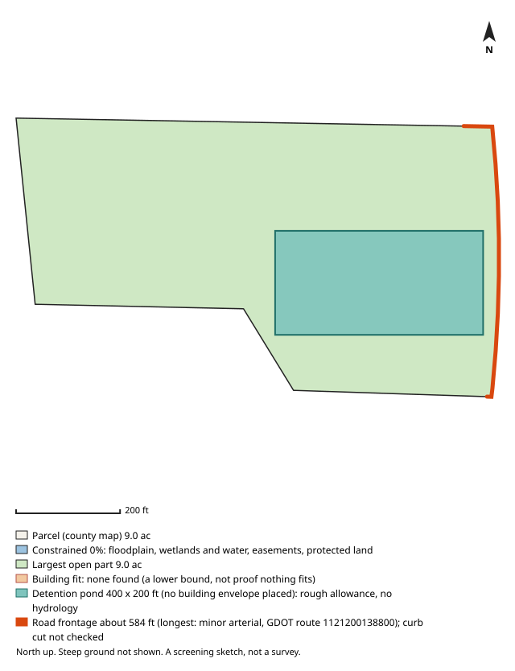

# #46 — 5015 WELCOME ALL RD (South Fulton / unincorporated)

**Score 71.5** (zoning & ground 86.6, access/land/seller 63.3, seller motivation 50.0) · parcel `09F350001311038` · [map](https://www.google.com/maps/search/?api=1&query=33.617648,-84.526485) · county record: https://qpublic.schneidercorp.com/Application.aspx?AppID=1010

**Lead grade B**
- Found: no building envelope found (a lower bound, not proof)

## The site
- 6.3 acres; about 6.0 usable after floodplain, mapped wetlands and ponds, protected land / conservation easements and steep ground. Utility and access easements are not checked
- Zoning: M-2 (Heavy Industrial); future land use: Industrial Mix-Use Zone
- Entitlement path: **by_right** — zoned industrial
- Access: 2.29 mi (straight line) to I-85 exit 68; road: Paved
- Rail: 98 ft to CSXT
- Industrial parcels within 1 mile: 46
- Floodplain 0% (none), floodway 0%, wetlands 0%, ponds/streams 0%
- Slope: 5% of the open ground steeper than 15%; relief about 28 ft (USGS lidar 2018-19, 10 m grid)
- Earthwork (rough): about 33,000 cubic yards of cut balanced by the same fill, 4.6 ft average cut or fill, to level the open ground (USGS lidar 2018-19, 10 m grid); one flat pad at the mean elevation of the open ground, not a grading plan: ignores drainage slope, terracing, shrink/swell, topsoil and rock
- Building fit: no fit found for the smallest envelope (building + truck court + trailer parking, 400 x 445 ft) (no envelope placement found); largest open-ground part 9.0 acres. The search is a lower bound, so this is not proof that nothing fits. Checked on open ground inside a 25 ft lot-line setback; open ground excludes floodplain (FEMA SFHA), mapped wetlands and water (NWI), conservation easements (NCED) and protected land (PAD-US); steep ground is not located (slope is applied only as a share, in usable_after_slope), so steep ground may lie inside the open area; car parking, drives, detention, access, coverage caps and zoning setbacks beyond the 25 ft lot-line setback are not modelled
- Detention pond (rough allowance): a 400 x 200 ft pond (top of bank; 6 ft deep, 4:1 side slopes, about 9.1 acre-feet; 1.84 acres, 20.3% of the open ground) fits on the open ground; no building envelope was placed, so this does not show room for both. Checked inside the 25 ft lot-line setback, on open ground (the same open ground as the building fit; steep ground is not located); a rough allowance for one fixed prototype pond, not a stormwater design: no hydrology, no NOAA Atlas 14 rainfall, no runoff from the building's impervious area and no local detention rules; the pond may sit right against the envelope with no room left for access, grading or a buffer; the real pond may be larger, smaller, underground or shared
- Soils (USDA SSURGO, 2 map units, 100% of the parcel shape mapped): hydrologic soil group mostly B (100% of the mapped soil); hydric components 0%; poorly or very poorly drained 0%; very limited for dwellings without basements (a slab-on-grade proxy) 0%. SSURGO is mapped at about 1:12,000 to 1:24,000 and rated by map unit, not this site: small wet spots, fill and inclusions go unmapped, and it is no substitute for a geotechnical report or a wetland delineation
- Road frontage (GDOT road centrelines): about 584 ft; longest on minor arterial, GDOT route 1121200138800 (584 ft). Measured as the parcel line within 50 ft of a GDOT road centreline, from the county parcel map: up to about 50 ft at each end of a frontage can be a side line near the corner, a wide right-of-way or a misaligned map can hide real frontage, and a road can be close without legal access. Curb cut / driveway access not checked: a manual next step (GDOT for state routes, the city or county for local roads)
- Water / sewer per assessor: All public / unknown
- Opportunity Zone: no

## Site plan

_North up, drawn from the county parcel map: shaded blue is floodplain, mapped wetlands and water, conservation easements and protected land; green is the largest open part; the outlined block is the fitted building envelope and the teal block, when drawn, is the rough detention pond allowance. Steep ground is not shown. A screening sketch, not a survey._

## The owner
- CHESTER INDUSTRIAL PARK ASSOC L P (entity)
- Mailing address: 54 W ALLENDALE AVE, ALLENDALE NJ 07401
- Last recorded sale: 2001-03-30 for $356,522 (Warranty Deed)
- Assessor land value: $107,400 ($17,048/acre)

## Why it ranks here
- zoned industrial
- mostly gentle ground
- 2.3 mi to I-85 exit 68
- 6 usable acres
- 46 industrial parcels within 1 mile
- rail-adjacent (CSXT within 300 ft)
- same owner for 26 years
- owner mails from out of state (NJ)

## Watch-outs
- owner name reads like an industrial company or developer vehicle

## Next steps
- Confirm zoning and any conditions with City of South Fulton planning (Fulton County if unincorporated)
- Confirm a curb cut / driveway permit for truck access (GDOT for a state route, the city or county for a local road): not checked by the screen
- Ask the water/sewer provider about capacity and the nearest main
- Pull title and recent deeds before approaching the owner
- Drive the site: access, neighbours, visible fill or dumping

_Screening estimate from public data (county assessor, FEMA, USFWS, USGS, EPA, GA EPD, GDOT). Not a survey, title search or environmental assessment._
