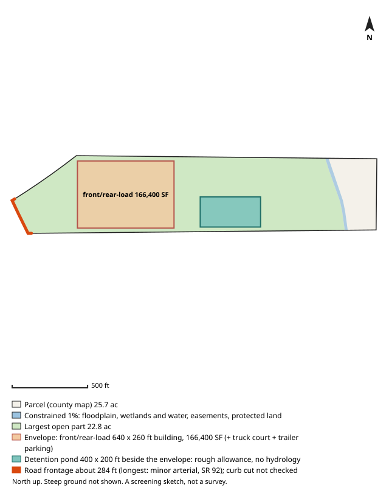

# #8 — 0 SPENCE RD (South Fulton / unincorporated)

**Score 78.6** (zoning & ground 84.3, access/land/seller 75.5, seller motivation 35.0) · parcel `09F100100460636` · [map](https://www.google.com/maps/search/?api=1&query=33.554521,-84.568422) · county record: https://qpublic.schneidercorp.com/Application.aspx?AppID=1010

**Lead grade A**: zoning path, building fit, pond room, road frontage, slope and soils all came back clear, and no watch item was found

## The site
- 27.0 acres; about 24.4 usable after floodplain, mapped wetlands and ponds, protected land / conservation easements and steep ground. Utility and access easements are not checked
- Zoning: M-1 (Light Industrial); future land use: Industrial Zone
- Entitlement path: **by_right** — zoned industrial
- Access: 0.77 mi (straight line) to I-85 exit 61; road: Paved
- Rail: 2,828 ft to CSXT
- Industrial parcels within 1 mile: 16
- Floodplain 0% (none), floodway 0%, wetlands 1%, ponds/streams 0%
- Slope: 9% of the open ground steeper than 15%; relief about 80 ft (USGS lidar 2018-19, 10 m grid)
- Earthwork (rough): about 400,000 cubic yards of cut balanced by the same fill, 19.4 ft average cut or fill, to level the open ground (USGS lidar 2018-19, 10 m grid); one flat pad at the mean elevation of the open ground, not a grading plan: ignores drainage slope, terracing, shrink/swell, topsoil and rock
- Building fit (lower bound): a front/rear-load envelope (building + truck court + trailer parking) fits with a 640 x 260 ft building (166,400 SF); largest open-ground part 22.8 acres. Checked on open ground inside a 25 ft lot-line setback; open ground excludes floodplain (FEMA SFHA), mapped wetlands and water (NWI), conservation easements (NCED) and protected land (PAD-US); steep ground is not located (slope is applied only as a share, in usable_after_slope), so steep ground may lie inside the open area; car parking, drives, detention, access, coverage caps and zoning setbacks beyond the 25 ft lot-line setback are not modelled
- Detention pond (rough allowance): a 400 x 200 ft pond (top of bank; 6 ft deep, 4:1 side slopes, about 9.1 acre-feet; 1.84 acres, 7.2% of the open ground) fits on the open ground left beside the fitted building envelope. Checked inside the 25 ft lot-line setback, on open ground (the same open ground as the building fit; steep ground is not located); a rough allowance for one fixed prototype pond, not a stormwater design: no hydrology, no NOAA Atlas 14 rainfall, no runoff from the building's impervious area and no local detention rules; the pond may sit right against the envelope with no room left for access, grading or a buffer; the real pond may be larger, smaller, underground or shared
- Soils (USDA SSURGO, 5 map units, 100% of the parcel shape mapped): hydrologic soil group mostly B (82% of the mapped soil; also A/D 18%); hydric components 1%; poorly or very poorly drained 0%; very limited for dwellings without basements (a slab-on-grade proxy) 18%. SSURGO is mapped at about 1:12,000 to 1:24,000 and rated by map unit, not this site: small wet spots, fill and inclusions go unmapped, and it is no substitute for a geotechnical report or a wetland delineation
- Road frontage (GDOT road centrelines): about 284 ft; longest on minor arterial, SR 92 (284 ft). Measured as the parcel line within 50 ft of a GDOT road centreline, from the county parcel map: up to about 50 ft at each end of a frontage can be a side line near the corner, a wide right-of-way or a misaligned map can hide real frontage, and a road can be close without legal access. Curb cut / driveway access not checked: a manual next step (GDOT for state routes, the city or county for local roads)
- Water / sewer per assessor: All public / unknown
- Opportunity Zone: no

## Site plan

_North up, drawn from the county parcel map: shaded blue is floodplain, mapped wetlands and water, conservation easements and protected land; green is the largest open part; the outlined block is the fitted building envelope and the teal block, when drawn, is the rough detention pond allowance. Steep ground is not shown. A screening sketch, not a survey._

## The owner
- MAPCO FARMS LLC (entity)
- Mailing address: 5761 CEDAR GROVE CIR, PLANO TX 75093
- Last recorded sale: 2012-12-13
- Assessor land value: $323,800 ($11,975/acre)

## Why it ranks here
- zoned industrial
- mostly gentle ground
- 0.8 mi to I-85 exit 61
- 24 usable acres
- 16 industrial parcels within 1 mile
- same owner for 14 years
- owner mails from out of state (TX)

## Watch-outs
- 1% mapped wetlands (1980s NWI; field delineation needed)
- Same owner: the same tax-roll owner name and mailing address is on 8 other 5-50 ac parcels in the jurisdictions searched (199.8 ac with this one): 09F070000320661 (ranked #81), 09F070000320927 (ranked #4), 09F100100460610 (ranked #129), 09F100200471269 (ranked #41), 09F100200471293 (ranked #230), and 3 more. Counts cover only that band and area
- Same owner, adjacent: touching or within 10 ft of 6 of them on the county parcel map, directly or through each other: 180.5 ac together with this one, larger than the 5-50 ac search band. Check the shared boundary: a corner touch is not frontage

## Next steps
- Confirm zoning and any conditions with City of South Fulton planning (Fulton County if unincorporated)
- Confirm a curb cut / driveway permit for truck access (GDOT for a state route, the city or county for a local road): not checked by the screen
- Ask the water/sewer provider about capacity and the nearest main
- Pull title and recent deeds before approaching the owner
- Drive the site: access, neighbours, visible fill or dumping

_Screening estimate from public data (county assessor, FEMA, USFWS, USGS, EPA, GA EPD, GDOT). Not a survey, title search or environmental assessment._
