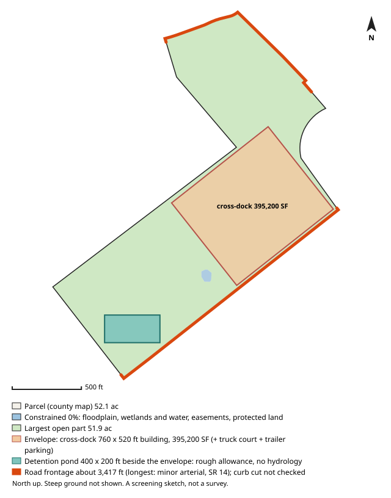

# #55 — 0 JOHN RIVERS RD (Fairburn)

**Score 69.0** (zoning & ground 52.1, access/land/seller 78.2, seller motivation 35.0) · parcel `09F090200490304` · [map](https://www.google.com/maps/search/?api=1&query=33.556898,-84.596244) · county record: https://qpublic.schneidercorp.com/Application.aspx?AppID=1010

**Lead grade B**
- Found: zoning path only possible (rezoning likely needed)

## The site
- 46.9 acres; about 45.0 usable after floodplain, mapped wetlands and ponds, protected land / conservation easements and steep ground. Utility and access easements are not checked
- Zoning: PD; future land use: TCMU
- Entitlement path: **possible** — rezoning likely needed
- Access: 1.31 mi (straight line) to I-85 exit 61; road: Paved
- Rail: 66 ft to CSXT
- Industrial parcels within 1 mile: 69
- Floodplain 0% (none), floodway 0%, wetlands 0%, ponds/streams 0%
- Slope: 4% of the open ground steeper than 15%; relief about 34 ft (USGS lidar 2018-19, 10 m grid)
- Earthwork (rough): about 290,000 cubic yards of cut balanced by the same fill, 7.0 ft average cut or fill, to level the open ground (USGS lidar 2018-19, 10 m grid); one flat pad at the mean elevation of the open ground, not a grading plan: ignores drainage slope, terracing, shrink/swell, topsoil and rock
- Building fit (lower bound): a cross-dock envelope (building + truck court + trailer parking) fits with a 760 x 520 ft building (395,200 SF); largest open-ground part 51.9 acres; a cross-dock fit means the front/rear-load envelope fits too. Checked on open ground inside a 25 ft lot-line setback; open ground excludes floodplain (FEMA SFHA), mapped wetlands and water (NWI), conservation easements (NCED) and protected land (PAD-US); steep ground is not located (slope is applied only as a share, in usable_after_slope), so steep ground may lie inside the open area; car parking, drives, detention, access, coverage caps and zoning setbacks beyond the 25 ft lot-line setback are not modelled
- Detention pond (rough allowance): a 400 x 200 ft pond (top of bank; 6 ft deep, 4:1 side slopes, about 9.1 acre-feet; 1.84 acres, 3.5% of the open ground) fits on the open ground left beside the fitted building envelope. Checked inside the 25 ft lot-line setback, on open ground (the same open ground as the building fit; steep ground is not located); a rough allowance for one fixed prototype pond, not a stormwater design: no hydrology, no NOAA Atlas 14 rainfall, no runoff from the building's impervious area and no local detention rules; the pond may sit right against the envelope with no room left for access, grading or a buffer; the real pond may be larger, smaller, underground or shared
- Soils (USDA SSURGO, 5 map units, 100% of the parcel shape mapped): hydrologic soil group mostly B (75% of the mapped soil; also C 17%, A/D 3%); hydric components 0%; poorly or very poorly drained 0%; very limited for dwellings without basements (a slab-on-grade proxy) 3%; unrated share of the mapped soil: soil group 6%, drainage 6%, dwellings rating 6%. SSURGO is mapped at about 1:12,000 to 1:24,000 and rated by map unit, not this site: small wet spots, fill and inclusions go unmapped, and it is no substitute for a geotechnical report or a wetland delineation
- Road frontage (GDOT road centrelines): about 3,417 ft; longest on minor arterial, SR 14 (2,022 ft); also minor arterial, GDOT route 1121200063109 827 ft, local road, GDOT route 1121200064309 615 ft, local road, GDOT route 1121200408114 59 ft. Measured as the parcel line within 50 ft of a GDOT road centreline, from the county parcel map: up to about 50 ft at each end of a frontage can be a side line near the corner, a wide right-of-way or a misaligned map can hide real frontage, and a road can be close without legal access. Curb cut / driveway access not checked: a manual next step (GDOT for state routes, the city or county for local roads)
- Water / sewer per assessor: Well / Septic/Approved
- Opportunity Zone: no

## Site plan

_North up, drawn from the county parcel map: shaded blue is floodplain, mapped wetlands and water, conservation easements and protected land; green is the largest open part; the outlined block is the fitted building envelope and the teal block, when drawn, is the rough detention pond allowance. Steep ground is not shown. A screening sketch, not a survey._

## The owner
- REGIONAL BUILDING COMMITTEE OF JEHOVAH'S WITNESSES INC (entity)
- Mailing address: 1005 RED MILLS RD, WALLKILL NY 12589
- Last recorded sale: 2014-05-16 for $1,641,115
- Assessor land value: $1,532,500 ($32,683/acre)

## Why it ranks here
- rezoning likely needed
- mostly gentle ground
- 1.3 mi to I-85 exit 61
- 45 usable acres
- 69 industrial parcels within 1 mile
- rail-adjacent (CSXT within 300 ft)
- same owner for 12 years
- owner mails from out of state (NY)

## Watch-outs
- assessor shows well/septic: public water or sewer may need extending

## Next steps
- Confirm zoning and any conditions with Fairburn planning
- Confirm a curb cut / driveway permit for truck access (GDOT for a state route, the city or county for a local road): not checked by the screen
- Ask the water/sewer provider about capacity and the nearest main
- Pull title and recent deeds before approaching the owner
- Drive the site: access, neighbours, visible fill or dumping

_Screening estimate from public data (county assessor, FEMA, USFWS, USGS, EPA, GA EPD, GDOT). Not a survey, title search or environmental assessment._
