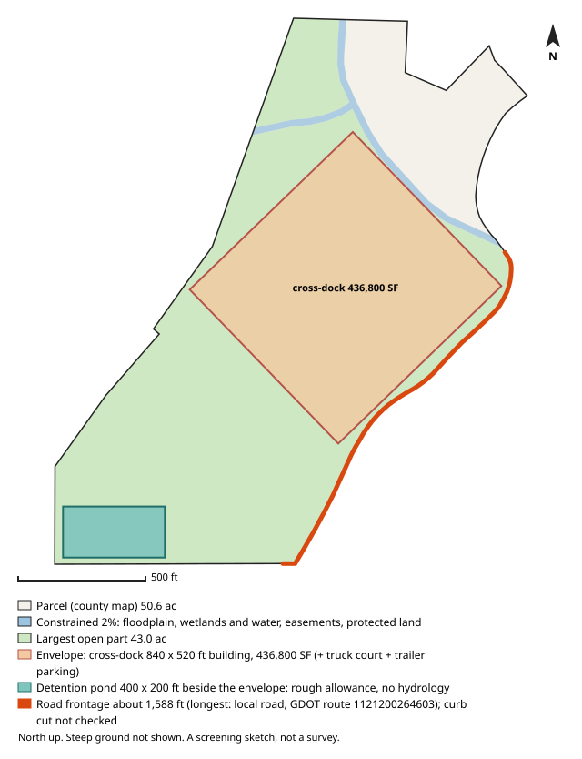

# #51 — 0 WATTS RD NW (Atlanta)

**Score 71.2** (zoning & ground 63.3, access/land/seller 75.5, seller motivation 35.0) · parcel `17 0261  LL0686` · [map](https://www.google.com/maps/search/?api=1&query=33.791043,-84.487241) · county record: https://qpublic.schneidercorp.com/Application.aspx?AppID=1010

**Lead grade B**
- Found: the same owner holds 1 built-on parcel adjacent to this one, directly or through its other parcels (possibly spare land of an operating site)

## The site
- 42.6 acres; about 31.4 usable after floodplain, mapped wetlands and ponds, protected land / conservation easements and steep ground. Utility and access easements are not checked
- Zoning: C-1-C; future land use: Industrial
- Entitlement path: **likely** — future land use map calls for industrial
- Access: 0.44 mi (straight line) to I-285 exit 12; road: Paved
- Rail: 3,023 ft to NS
- Industrial parcels within 1 mile: 69
- Floodplain 0% (none), floodway 0%, wetlands 0%, ponds/streams 2%
- Slope: 25% of the open ground steeper than 15%; relief about 100 ft (USGS lidar 2018-19, 10 m grid)
- Earthwork (rough): about 1,200,000 cubic yards of cut balanced by the same fill, 30.5 ft average cut or fill, to level the open ground (USGS lidar 2018-19, 10 m grid); one flat pad at the mean elevation of the open ground, not a grading plan: ignores drainage slope, terracing, shrink/swell, topsoil and rock
- Building fit (lower bound): a cross-dock envelope (building + truck court + trailer parking) fits with a 840 x 520 ft building (436,800 SF); largest open-ground part 43.0 acres; a cross-dock fit means the front/rear-load envelope fits too. Checked on open ground inside a 25 ft lot-line setback; open ground excludes floodplain (FEMA SFHA), mapped wetlands and water (NWI), conservation easements (NCED) and protected land (PAD-US); steep ground is not located (slope is applied only as a share, in usable_after_slope), so steep ground may lie inside the open area; car parking, drives, detention, access, coverage caps and zoning setbacks beyond the 25 ft lot-line setback are not modelled
- Detention pond (rough allowance): a 400 x 200 ft pond (top of bank; 6 ft deep, 4:1 side slopes, about 9.1 acre-feet; 1.84 acres, 3.7% of the open ground) fits on the open ground left beside the fitted building envelope. Checked inside the 25 ft lot-line setback, on open ground (the same open ground as the building fit; steep ground is not located); a rough allowance for one fixed prototype pond, not a stormwater design: no hydrology, no NOAA Atlas 14 rainfall, no runoff from the building's impervious area and no local detention rules; the pond may sit right against the envelope with no room left for access, grading or a buffer; the real pond may be larger, smaller, underground or shared
- Soils (USDA SSURGO, 6 map units, 100% of the parcel shape mapped): hydrologic soil group largest rated group A/D (22% of the mapped soil; also C 4%); hydric components 2%; poorly or very poorly drained 0%; very limited for dwellings without basements (a slab-on-grade proxy) 22%; unrated share of the mapped soil: soil group 74%, drainage 74%, dwellings rating 74%. SSURGO is mapped at about 1:12,000 to 1:24,000 and rated by map unit, not this site: small wet spots, fill and inclusions go unmapped, and it is no substitute for a geotechnical report or a wetland delineation
- Road frontage (GDOT road centrelines): about 1,588 ft; longest on local road, GDOT route 1121200264603 (1,588 ft). Measured as the parcel line within 50 ft of a GDOT road centreline, from the county parcel map: up to about 50 ft at each end of a frontage can be a side line near the corner, a wide right-of-way or a misaligned map can hide real frontage, and a road can be close without legal access. Curb cut / driveway access not checked: a manual next step (GDOT for state routes, the city or county for local roads)
- Water / sewer per assessor: All public / unknown
- Opportunity Zone: no

## Site plan

_North up, drawn from the county parcel map: shaded blue is floodplain, mapped wetlands and water, conservation easements and protected land; green is the largest open part; the outlined block is the fitted building envelope and the teal block, when drawn, is the rough detention pond allowance. Steep ground is not shown. A screening sketch, not a survey._

## The owner
- HPT PSC PROPERTIES LLC (entity)
- Mailing address: 24601 CENTER RIDGE RD STE 200, WESTLAKE OH 44145-5634
- Last recorded sale: 2007-05-30 for $5,421,145
- Assessor land value: $971,100 ($22,785/acre)

## Why it ranks here
- future land use map calls for industrial
- 0.4 mi to I-285 exit 12
- 31 usable acres
- 69 industrial parcels within 1 mile
- same owner for 20 years
- owner mails from out of state (OH)

## Watch-outs
- Same owner: the same tax-roll owner name and mailing address is on 1 other 5-50 ac parcel in the jurisdictions searched (58.7 ac with this one): 17 026000030295 (screened out: already built on). Counts cover only that band and area
- Same owner, adjacent: touching or within 10 ft of 1 of them on the county parcel map, directly or through each other: 58.7 ac together with this one, larger than the 5-50 ac search band. Check the shared boundary: a corner touch is not frontage
- Same owner, adjacent and built on: 1 same-owner parcel adjacent to this one, directly or through each other, is already built on (17 026000030295). This may be spare land of an operating site rather than land for sale

## Next steps
- Confirm zoning and any conditions with Atlanta planning
- Confirm a curb cut / driveway permit for truck access (GDOT for a state route, the city or county for a local road): not checked by the screen
- Ask the water/sewer provider about capacity and the nearest main
- Pull title and recent deeds before approaching the owner
- Drive the site: access, neighbours, visible fill or dumping

_Screening estimate from public data (county assessor, FEMA, USFWS, USGS, EPA, GA EPD, GDOT). Not a survey, title search or environmental assessment._
