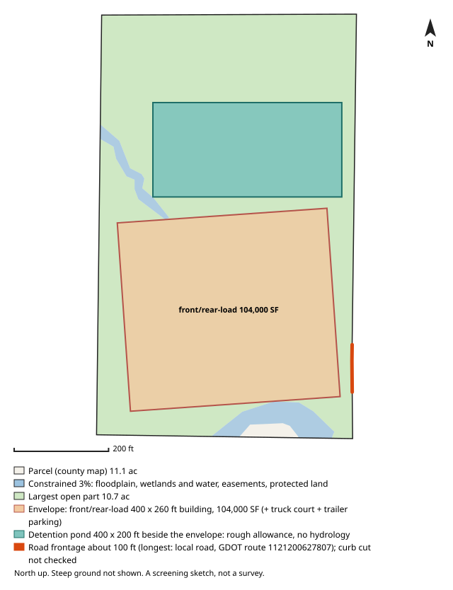

# #142 — 1688 EMPIRE AVE (East Point)

**Score 65.0** (zoning & ground 78.1, access/land/seller 57.9, seller motivation 35.0) · parcel `14 0155  LL0278` · [map](https://www.google.com/maps/search/?api=1&query=33.694392,-84.444648) · county record: https://qpublic.schneidercorp.com/Application.aspx?AppID=1010

**Lead grade A**: zoning path, building fit, pond room, road frontage, slope and soils all came back clear, and no watch item was found

## The site
- 10.2 acres; about 8.0 usable after floodplain, mapped wetlands and ponds, protected land / conservation easements and steep ground. Utility and access easements are not checked
- Zoning: I1; future land use: MXD
- Entitlement path: **by_right** — zoned industrial
- Access: 2.1 mi (straight line) to I-85 exit 76; road: Paved
- Rail: 2,498 ft to NS
- Industrial parcels within 1 mile: 54
- Floodplain 3% (AE), floodway 1%, wetlands 0%, ponds/streams 0%
- Slope: 19% of the open ground steeper than 15%; relief about 28 ft (USGS lidar 2018-19, 10 m grid)
- Earthwork (rough): about 60,000 cubic yards of cut balanced by the same fill, 7.0 ft average cut or fill, to level the open ground (USGS lidar 2018-19, 10 m grid); one flat pad at the mean elevation of the open ground, not a grading plan: ignores drainage slope, terracing, shrink/swell, topsoil and rock
- Building fit (lower bound): a front/rear-load envelope (building + truck court + trailer parking) fits with a 400 x 260 ft building (104,000 SF); largest open-ground part 10.7 acres. Checked on open ground inside a 25 ft lot-line setback; open ground excludes floodplain (FEMA SFHA), mapped wetlands and water (NWI), conservation easements (NCED) and protected land (PAD-US); steep ground is not located (slope is applied only as a share, in usable_after_slope), so steep ground may lie inside the open area; car parking, drives, detention, access, coverage caps and zoning setbacks beyond the 25 ft lot-line setback are not modelled
- Detention pond (rough allowance): a 400 x 200 ft pond (top of bank; 6 ft deep, 4:1 side slopes, about 9.1 acre-feet; 1.84 acres, 17.1% of the open ground) fits on the open ground left beside the fitted building envelope. Checked inside the 25 ft lot-line setback, on open ground (the same open ground as the building fit; steep ground is not located); a rough allowance for one fixed prototype pond, not a stormwater design: no hydrology, no NOAA Atlas 14 rainfall, no runoff from the building's impervious area and no local detention rules; the pond may sit right against the envelope with no room left for access, grading or a buffer; the real pond may be larger, smaller, underground or shared
- Soils (USDA SSURGO, 1 map unit, 100% of the parcel shape mapped): no hydrologic soil group rated; hydric components 0%; poorly or very poorly drained none rated; very limited for dwellings without basements (a slab-on-grade proxy) none rated; unrated share of the mapped soil: soil group 100%, drainage 100%, dwellings rating 100%. SSURGO is mapped at about 1:12,000 to 1:24,000 and rated by map unit, not this site: small wet spots, fill and inclusions go unmapped, and it is no substitute for a geotechnical report or a wetland delineation
- Road frontage (GDOT road centrelines): about 100 ft; longest on local road, GDOT route 1121200627807 (100 ft). Measured as the parcel line within 50 ft of a GDOT road centreline, from the county parcel map: up to about 50 ft at each end of a frontage can be a side line near the corner, a wide right-of-way or a misaligned map can hide real frontage, and a road can be close without legal access. Curb cut / driveway access not checked: a manual next step (GDOT for state routes, the city or county for local roads)
- Water / sewer per assessor: All public / unknown
- Opportunity Zone: no

## Site plan

_North up, drawn from the county parcel map: shaded blue is floodplain, mapped wetlands and water, conservation easements and protected land; green is the largest open part; the outlined block is the fitted building envelope and the teal block, when drawn, is the rough detention pond allowance. Steep ground is not shown. A screening sketch, not a survey._

## The owner
- MULLINS BROS (individual)
- Mailing address: 1692 EMPIRE AVE, EAST POINT GA 30344
- Last recorded sale: none on file
- Assessor land value: $2,341,800 ($228,691/acre)

## Why it ranks here
- zoned industrial
- 2.1 mi to I-85 exit 76
- 8 usable acres
- 54 industrial parcels within 1 mile
- no recorded sale on file (likely long-held)
- individual owner

## Watch-outs
- 3% in the 100-year floodplain

## Next steps
- Confirm zoning and any conditions with East Point planning
- Confirm a curb cut / driveway permit for truck access (GDOT for a state route, the city or county for a local road): not checked by the screen
- Ask the water/sewer provider about capacity and the nearest main
- Pull title and recent deeds before approaching the owner
- Drive the site: access, neighbours, visible fill or dumping

_Screening estimate from public data (county assessor, FEMA, USFWS, USGS, EPA, GA EPD, GDOT). Not a survey, title search or environmental assessment._
